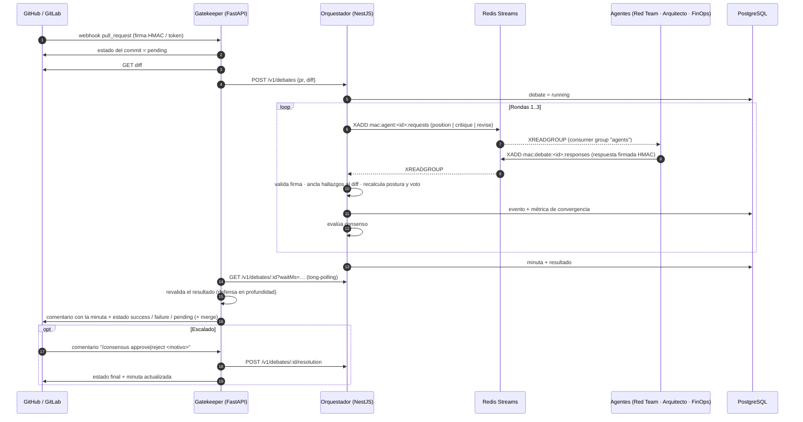
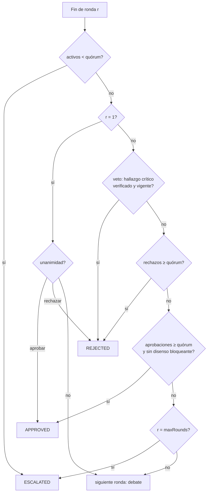

# MultiAgent Consensus

**Orquestador de consenso multi-agente para GitOps & Architecture PR Gates.**

Cada Pull Request / Merge Request se somete a un debate automatizado entre tres agentes con incentivos opuestos
(**Red Team**, **Arquitecto**, **Business/FinOps**). Un motor de consenso inspirado en tolerancia a fallos bizantinos
decide si el cambio se **aprueba**, se **rechaza** o se **escala a un ingeniero senior**, y adjunta al PR una
**minuta ejecutiva** con el resumen del debate, los riesgos mitigados y las condiciones de merge.

```
                              +---------------------------------------+
                              |         GitOps Pull Request           |
                              |   (Cambio de Código / Infraestructura)|
                              +-------------------+-------------------+
                                                  |  webhook
                                                  v
                              +-------------------+-------------------+
                              |  gatekeeper/  (Python · FastAPI)      |
                              |  firma HMAC · diff · estado del commit|
                              +-------------------+-------------------+
                                                  |  POST /v1/debates
                                                  v
                              +-------------------+-------------------+
                              | orchestrator/ (Node · NestJS)         |
                              | Debate multi-turn sobre Redis Streams |
                              +-------------------+-------------------+
                                                  |
     +--------------------------------------------+--------------------------------------------+
     |                                            |                                            |
     v                                            v                                            v
+----+--------------------+              +--------+-----------------+              +-----------+----------------+
| agents/red_team.ts      |              | agents/architect.ts      |              | agents/business_ops.ts     |
| OWASP · ataque · fugas  |              | SOLID · deuda técnica    |              | Coste · SLA/SLO · impacto  |
+----+--------------------+              +--------+-----------------+              +-----------+----------------+
     |                                            |                                            |
     +--------------------------------------------+--------------------------------------------+
                                                  |
                                                  v
                              +-------------------+-------------------+
                              |  Evaluador de Consenso (BFT-style)    |
                              |  Matriz de Convergencia Multi-Turno   |
                              +-------------------+-------------------+
                                                  |
                                                  v
+-------------------+         +-------------------+-------------------+
| Human Escalation  | <-------+     Veredicto del gatekeeper           |
| /consensus ...    |         | success · failure · pending (+merge)  |
+-------------------+         +-------------------+-------------------+

            Redis Streams = bus asíncrono            PostgreSQL = minutas · log del debate · métricas
```

---

## Contenido

1. [Inicio rápido](#inicio-rápido)
2. [Estructura del repositorio](#estructura-del-repositorio)
3. [Flujo completo](#flujo-completo)
4. [Especificación del protocolo de consenso](#especificación-del-protocolo-de-consenso)
5. [Los tres agentes](#los-tres-agentes)
6. [Garantías bizantinas (qué se verifica y cómo)](#garantías-bizantinas)
7. [Minuta ejecutiva](#minuta-ejecutiva)
8. [Integración con GitHub y GitLab](#integración-con-github-y-gitlab)
9. [API del orquestador](#api-del-orquestador)
10. [Configuración](#configuración)
11. [Persistencia (PostgreSQL)](#persistencia-postgresql)
12. [Capa LLM (Claude / Ollama)](#capa-llm-claude--ollama)
13. [Desarrollo y tests](#desarrollo-y-tests)
14. [Alcance y limitaciones](#alcance-y-limitaciones)

---

## Inicio rápido

### Demo local (sin Redis, sin Postgres, sin red)

```bash
npm install
npx ts-node orchestrator/src/cli.ts examples/risky_secret.diff --title "Añade config AWS"
```

El CLI ejecuta el debate completo con un bus en memoria y escribe la minuta en stdout. Código de salida:
`0` aprobado · `1` rechazado · `3` escalado a humano. En `examples/` hay cuatro diffs que cubren los tres desenlaces.

### Stack completo (Docker Compose)

```bash
cp .env.example .env        # define POSTGRES_PASSWORD, BUS_SECRET, ORCHESTRATOR_API_KEY y los secretos de webhook
docker compose up --build
# opcional: LLM local
docker compose --profile ollama up --build
```

| Servicio       | Puerto | Función                                                    |
|----------------|--------|------------------------------------------------------------|
| `gatekeeper`   | 8000   | Webhooks `/webhooks/github` y `/webhooks/gitlab`           |
| `orchestrator` | 3000   | API REST del debate (`/v1/debates`), `/health`             |
| `redis`        | —      | Redis Streams: mensajería asíncrona entre agentes          |
| `postgres`     | —      | Minutas, log de eventos del debate, métricas de convergencia |

---

## Estructura del repositorio

```
agents/                   Agentes (TypeScript) — análisis, crítica y revisión
  protocol.ts             Tipos del protocolo (Finding, AgentReview, Rebuttal, …)
  base_agent.ts           Ciclo position → critique → revise, capa LLM opcional, firma HMAC
  red_team.ts             OWASP Top 10, vectores de ataque, fugas de datos, IaC insegura
  architect.ts            SOLID, acoplamiento, complejidad, duplicación, API pública, tests
  business_ops.ts         Coste de infraestructura, SLA/SLO, migraciones destructivas
  scoring.ts              Riesgo noisy-OR, modelo de influencia, umbrales de voto
  grounding.ts            Verificación de evidencia contra el diff
  llm.ts                  Proveedores Claude / Ollama
orchestrator/             Orquestador (NestJS)
  src/debate/             Motor de debate, workers de agentes, minutas, servicio
  src/consensus/          Evaluador de consenso + validador autoritativo de revisiones
  src/bus/                Redis Streams (producción) y bus en memoria (tests/CLI)
  src/store/              PostgreSQL (producción) y almacén en memoria
  src/api/                Controladores REST, guard de API key
gatekeeper/               Gatekeeper (FastAPI)
  app/main.py             Webhooks GitHub/GitLab (firma/token), comandos humanos
  app/service.py          PR → debate → veredicto → estado/comentario/merge
  app/policy.py           Revalidación del resultado y mapeo a veredicto
  app/vcs/                Clientes GitHub y GitLab
db/init.sql               Esquema de PostgreSQL
examples/                 Diffs de demostración
docker-compose.yml        Redis + PostgreSQL + orquestador + gatekeeper (+ Ollama)
```

---

## Flujo completo



---

## Especificación del protocolo de consenso

### 1. Fases de una ronda

| Ronda | Fase        | Qué hace cada agente                                                                                          |
|-------|-------------|---------------------------------------------------------------------------------------------------------------|
| 1     | `position`  | Posición **ciega**: analiza el diff y emite hallazgos estructurados (JSON) con evidencia literal.              |
| ≥ 2   | `critique`  | Lee las revisiones de la ronda anterior y emite **contra-argumentos** a los hallazgos de sus pares.           |
| ≥ 2   | `revise`    | Recibe las objeciones dirigidas a él: **mantiene, rebaja o retira** hallazgos y actualiza su postura.         |

Todos los mensajes son JSON tipado (`agents/protocol.ts`). Los contra-argumentos tienen la forma:

```json
{ "from": "business_ops", "to": "red_team", "findingId": "red_team:eval:src/a.ts:1",
  "stance": "contest | corroborate | neutral", "argument": "…" }
```

- `contest`: el hallazgo parece sobredimensionado (el agente heurístico objeta si `confianza < 0.5`).
- `corroborate`: el hallazgo también afecta al dominio del que critica. Genera un **hallazgo derivado** en su
  dominio (p. ej. un secreto filtrado ⇒ *coste de incidente* para FinOps, *configuración embebida* para el Arquitecto),
  siempre **acotado a `medium`** para que un eco entre dominios nunca pueda, por sí solo, bloquear un PR.

### 2. Riesgo, postura y voto

Cada hallazgo tiene `severity ∈ {info, low, medium, high, critical}` y `confidence ∈ [0,1]`.

```
peso(info,low,medium,high,critical) = 0.02, 0.08, 0.25, 0.55, 0.90
riesgo de evidencia  e_i = 1 − Π (1 − peso(sev) · confianza)          (noisy-OR sobre hallazgos abiertos)
postura              x_i(1) = e_i                                      (ronda 1: ciega)
                     x_i(t+1) = λ_i · Σ_j W_ij · x_j(t) + (1 − λ_i) · e_i      (modelo de Friedkin–Johnsen)
```

`λ_i` es la **susceptibilidad** del agente (0 = terco, 1 = sólo sigue a sus pares) y `W_i·` su fila de confianza.
Los perfiles por defecto reflejan los incentivos opuestos:

| Agente         | `aprueba si x <` | `rechaza si x ≥` | λ (susceptibilidad) | Confía más en… |
|----------------|------------------|------------------|---------------------|----------------|
| Red Team       | 0.15             | 0.40             | 0.25 (muy terco)    | sí mismo       |
| Arquitecto     | 0.25             | 0.55             | 0.45                | Red Team       |
| Business/FinOps| 0.30             | 0.65             | 0.55                | Red Team       |

Voto: `approve` · `approve_with_conditions` (entre ambos umbrales) · `reject`.

**Invariante de seguridad.** La influencia social **no puede levantar un disenso bloqueante**: si el agente
mantiene un hallazgo `high`/`critical` con `confianza ≥ 0.6`, su voto es `reject` mientras el hallazgo siga
vigente. Sólo la **evidencia** —retirar o rebajar el hallazgo tras una objeción fundada— puede cambiarlo.

### 3. Regla de decisión (política de consenso)

`n` = nº de agentes (3). Quórum de **mayoría cualificada** = `⌈2n/3⌉` = 2. Los agentes expulsados no votan (ver §Garantías).



| Resultado   | Condición                                                                                                  |
|-------------|------------------------------------------------------------------------------------------------------------|
| `APPROVED`  | Unanimidad (R1), o desde R2 mayoría cualificada de aprobación **sin disenso bloqueante** (`high`/`critical`). |
| `REJECTED`  | Unanimidad de rechazo (R1); o desde R2 **veto** por hallazgo crítico verificado, o mayoría cualificada de rechazo. |
| `ESCALATED` | Sin consenso tras `MAX_ROUNDS` (3), o menos agentes activos que el quórum.                                   |

La ronda 1 sólo concluye con unanimidad: si no la hay, **siempre** se abre el debate con contra-argumentos.

### 4. Matriz de convergencia

Tras cada ronda se calcula la matriz de acuerdo entre agentes `A_ij = 1 − |x_i − x_j|` y la **tasa de convergencia**
`C = media de A_ij` (pares `i<j`). Se persiste por ronda (`convergence_metrics`) y se muestra en la minuta.

Ejemplo real (`examples/risky_secret.diff`, clave AWS en el código):

| Ronda | Red Team          | Arquitecto                | Business/FinOps | Convergencia | Resultado |
|-------|-------------------|---------------------------|-----------------|--------------|-----------|
| 1     | ⛔ rechaza (0.91) | ✅ aprueba (0.00)         | ✅ aprueba (0.00) | 39 %       | CONTINUE  |
| 2     | ⛔ rechaza (0.81) | 🟡 c/condiciones (0.25)   | ✅ aprueba (0.29) | 63 %       | **REJECTED** (veto) |

Ejemplo `examples/sql_injection.diff` (inyección SQL, severidad `high`, sin consenso):

| Ronda | Red Team | Arquitecto | Business/FinOps | Convergencia | Resultado |
|-------|----------|------------|-----------------|--------------|-----------|
| 1 | ⛔ 0.44 | ✅ 0.00 | ✅ 0.00 | 71 % | CONTINUE |
| 2 | ⛔ 0.40 | ✅ 0.16 | ✅ 0.17 | 84 % | CONTINUE (mayoría pero disenso bloqueante) |
| 3 | ⛔ 0.41 | ✅ 0.20 | ✅ 0.21 | 86 % | **ESCALATED** |

### 5. Human-in-the-Loop

Si no hay consenso tras 3 iteraciones, el orquestador genera la minuta ejecutiva y el gatekeeper deja el estado del
commit en `pending`. Un ingeniero senior resuelve comentando en el PR/MR:

```
/consensus approve <motivo>
/consensus reject  <motivo>
```

El gatekeeper comprueba que el autor del comentario esté en `GATEKEEPER_SENIOR_REVIEWERS` (si se define) **y** tenga
permiso de escritura en el repositorio; que exista un debate escalado para el **commit actual** (un push nuevo
invalida la escalada anterior); y registra revisor, decisión y motivo en la minuta y en PostgreSQL.

---

## Los tres agentes

Cada agente combina **análisis estático determinista** (siempre activo, funciona sin LLM) con una **capa LLM
opcional**. Los hallazgos sólo cuentan si están anclados al diff.

| Agente | Qué busca | Ejemplos de reglas |
|--------|-----------|--------------------|
| `red_team.ts` | OWASP Top 10, vectores de ataque, fugas de datos | Claves AWS / tokens / claves privadas (crítico), credenciales literales, `eval`, inyección de shell/SQL, XSS, deserialización insegura, MD5/SHA-1, TLS desactivado, CORS `*`, `0.0.0.0/0`, IAM `*`, contenedores privilegiados, buckets públicos, secretos en logs |
| `architect.ts` | Mantenibilidad, SOLID, deuda técnica | Funciones largas y complejidad ciclomática (SRP), clases "dios", dominio acoplado a infraestructura (DIP), cadenas `instanceof` (OCP), código duplicado (DRY), eliminación de API pública, supresiones de linter, TODO/FIXME, PR gigante, cambios sin tests |
| `business_ops.ts` | Coste, SLA/SLO, impacto financiero | Delta de coste mensual estimado en IaC (instancias EC2/RDS, réplicas, almacenamiento, IOPS, NAT, EKS…) frente al presupuesto; migraciones destructivas (`DROP`, `TRUNCATE`, `DELETE` sin `WHERE`), `CREATE INDEX` bloqueante, `NOT NULL` sin `DEFAULT`; probes/PDB/límites/alertas eliminados; imagen `latest`, estrategia `Recreate`, `maxUnavailable: 100%`, una réplica en prod |

Las confianzas se reducen a la mitad en ficheros de test/documentación. Las rutas de coste usan una tabla de precios
on-demand aproximada (`MONTHLY_BUDGET_USD` define el umbral: `≥ budget` ⇒ `high`, `≥ budget/5` ⇒ `medium`, `≥ budget/20` ⇒ `low`).

---

## Garantías bizantinas

El orquestador es el **coordinador de confianza**; los agentes (y su capa LLM) **no** lo son. Para cada respuesta:

| Amenaza                                   | Defensa                                                                                                         |
|-------------------------------------------|-----------------------------------------------------------------------------------------------------------------|
| Suplantación de un agente en el bus       | Cada respuesta lleva **HMAC-SHA256** con una clave por agente derivada de `BUS_SECRET`. Firma inválida ⇒ fallo.   |
| Agente caído o colgado                    | **Timeout** por petición (`AGENT_TIMEOUT_MS`) ⇒ el agente se **expulsa** del debate; el quórum se recalcula.     |
| Respuesta malformada                      | Validación estructural estricta ⇒ expulsión (`invalid`).                                                         |
| Alucinación / hallazgo inventado          | **Grounding**: cada evidencia debe existir literalmente en el diff (fichero + fragmento + lado). Si no ⇒ se descarta y se registra. Un hallazgo sin evidencia verificable no puede bloquear. |
| Hallazgos a nivel de PR sin evidencia     | Se aceptan pero **acotados a `medium`**.                                                                         |
| Votar "lo que conviene"                   | El voto y la postura declarados son **informativos**: el orquestador los **recalcula** de los hallazgos verificados. |
| Subir severidad / escalar tarde           | En `revise` no se puede subir la severidad de un hallazgo previo; los hallazgos tardíos se acotan a `medium`.    |
| Equivocación (dos respuestas distintas)   | La primera cuenta; una segunda respuesta válida pero distinta ⇒ `equivocation` ⇒ expulsión.                      |
| Amplificación entre agentes               | Los ecos entre dominios (`corroborate`) se acotan a `medium`; la influencia social no levanta un disenso bloqueante. |
| Fuga de secretos vía la propia minuta     | Claves, tokens y credenciales detectados se **enmascaran** (`[REDACTADO]`) antes de publicarse en el comentario del PR. |
| Contenido hostil en la minuta             | Títulos, snippets y argumentos se **escapan** (sin HTML activo ni menciones `@`).                                |
| Resultado inconsistente del orquestador   | El gatekeeper **revalida** (quórum, vetos, disenso) y **falla cerrado** (`failure`/`error`).                     |

> Honestidad sobre el alcance: no es un PBFT distribuido (que exigiría `n ≥ 3f+1` réplicas con el estado replicado).
> Es un esquema *BFT-style* con coordinador de confianza: la verificación independiente de cada mensaje sustituye
> a la replicación. Con `n = 3` y quórum 2, **un** agente defectuoso o malicioso no puede ni aprobar ni bloquear un PR
> por sí solo, salvo con un hallazgo verificable en el diff.

---

## Minuta ejecutiva

Se genera al concluir el debate (y se actualiza si un humano resuelve un escalado). Se publica como **un único
comentario** en el PR/MR (se edita en lugar de duplicarse). Secciones: veredicto y motivo · matriz de consenso por
ronda · hallazgos vigentes por agente (con evidencia y remediación) · **riesgos mitigados durante el debate**
(hallazgos retirados o rebajados) · condiciones de merge · intercambio de contra-argumentos · integridad del proceso
(afirmaciones descartadas, agentes expulsados) · decisión humana requerida/registrada.

Ver una minuta real: `npx ts-node orchestrator/src/cli.ts examples/risky_secret.diff`.

---

## Integración con GitHub y GitLab

El gatekeeper bloquea la rama publicando el **estado del commit** `multiagent-consensus`
(`success` / `failure` / `pending` / `error`). Para que bloquee de verdad, márcalo como *required status check*
en la protección de rama (GitHub) o activa *External status checks / Pipelines must succeed* (GitLab).

**GitHub** — webhook a `POST /webhooks/github`, content-type `application/json`, secreto = `GITHUB_WEBHOOK_SECRET`,
eventos *Pull requests* e *Issue comments*. Token con `pull_requests: write`, `statuses: write` (y `contents: write`
si `GATEKEEPER_AUTO_MERGE=true`). Se valida `X-Hub-Signature-256` con comparación en tiempo constante.

**GitLab** — webhook a `POST /webhooks/gitlab`, *Secret token* = `GITLAB_WEBHOOK_TOKEN`, eventos *Merge request* y *Comments*.
Token con scope `api`.

Comportamiento común:

- Acciones procesadas: PR abierto / reabierto / nuevos commits / listo para revisión (los *drafts* se ignoran).
- Idempotencia por `(PR, commit)`: reenvíos de webhook no duplican debates.
- `GATEKEEPER_AUTO_MERGE=true`: fusiona sólo con veredicto `APPROVED` (o aprobación humana) y **fija el SHA**, de modo que
  un push posterior invalida el merge.
- `GATEKEEPER_REQUEST_CHANGES=true` (GitHub): además publica una revisión *request changes* en los rechazos.
- Cualquier error (orquestador caído, diff inaccesible…) ⇒ estado `error` y comentario: **falla cerrado**.

---

## Configuración por repositorio

Cada repositorio puede ajustar el gate con un `.consensus.json` en su raíz (ejemplo: `examples/consensus.json`):

| Clave | Efecto |
|-------|--------|
| `monthlyBudgetUsd` | Presupuesto incremental de FinOps para ese repo (sustituye a `MONTHLY_BUDGET_USD`) |
| `maxRounds` | Rondas antes de escalar (1–5) |
| `ignorePaths` | Globs (`*`, `**`, `?`) de ficheros excluidos del debate: código generado, *vendor*, lockfiles |

El gatekeeper lo lee de la **rama base**, nunca de la del PR: el autor de un cambio no puede aflojar sus propias reglas.
Sólo se aceptan estas tres claves —no se puede desactivar el veto de seguridad—, el orquestador valida los rangos
(valores fuera de rango ⇒ `400`) y los ficheros ignorados quedan registrados en el log del debate (`diff.filtered`).
Un fichero ausente o ilegible ⇒ valores por defecto.

---

## API del orquestador

Autenticación: cabecera `x-api-key: $ORCHESTRATOR_API_KEY` (o `Authorization: Bearer …`). `/health` es público.

| Método | Ruta                              | Descripción                                                                     |
|--------|-----------------------------------|---------------------------------------------------------------------------------|
| POST   | `/v1/debates`                     | Inicia un debate (202). Idempotente por `(PR, headSha)`; `force:true` reintenta. |
| GET    | `/v1/debates/:id?waitMs=&full=`   | Estado/resultado. `waitMs` hace long-polling; `full=true` incluye todas las rondas. |
| GET    | `/v1/debates/:id/minutes`         | Minuta en Markdown.                                                             |
| GET    | `/v1/debates/:id/events`          | Log ordenado del debate (persistido).                                           |
| GET    | `/v1/debates/:id/metrics`         | Convergencia por ronda.                                                         |
| GET    | `/v1/debates?prId=github:o/r#7`   | Histórico de debates de un PR.                                                  |
| GET    | `/metrics`                        | Métricas Prometheus (debates por decisión, expulsiones por tipo, rondas, convergencia media, activos/en cola). |
| POST   | `/v1/debates/:id/resolution`      | Resolución humana `{reviewer, decision: approve\|reject, rationale}` (sólo si `escalated`). |

Cuerpo de `POST /v1/debates`:

```json
{ "pr": { "provider": "github", "repo": "acme/shop", "number": 7, "title": "…", "headSha": "abc1234",
          "diff": "diff --git a/…", "author": "dev", "description": "…" }, "force": false,
  "settings": { "monthlyBudgetUsd": 500, "maxRounds": 3, "ignorePaths": ["vendor/**"] } }
```

### Streams de Redis

| Stream                          | Contenido                                                           |
|---------------------------------|---------------------------------------------------------------------|
| `mac:agent:<agent>:requests`    | Peticiones `position` / `critique` / `revise` (consumer group `agents`) |
| `mac:debate:<id>:responses`     | Respuestas firmadas de los agentes (group `engine-<id>`)            |
| `mac:debate:<id>:events`        | Eventos del ciclo de vida del debate (observabilidad)               |

Los streams por debate expiran (`STREAM_TTL_SECONDS`, 7 días); el registro duradero está en PostgreSQL.

---

## Configuración

Variables del **orquestador**:

| Variable | Defecto | Descripción |
|----------|---------|-------------|
| `PORT` | `3000` | Puerto HTTP |
| `BUS_BACKEND` | `redis` | `redis` o `memory` |
| `REDIS_URL` | `redis://localhost:6379` | Redis Streams |
| `DATABASE_URL` | — | PostgreSQL; sin ella se usa almacenamiento en memoria |
| `BUS_SECRET` | — (obligatorio en producción) | Deriva las claves HMAC de los agentes |
| `ORCHESTRATOR_API_KEY` | — | Si se define, protege `/v1/*` |
| `MAX_ROUNDS` | `3` | Rondas antes de escalar |
| `MAX_CONCURRENT_DEBATES` | `4` | Debates simultáneos; el resto espera en cola |
| `VETO_ON_CRITICAL` | `true` | Un hallazgo crítico verificado veta el merge |
| `MONTHLY_BUDGET_USD` | `1000` | Umbral de incremento de coste (FinOps) |
| `AGENT_TIMEOUT_MS` | `120000` | Timeout por petición a un agente |
| `STREAM_TTL_SECONDS` | `604800` | Retención de streams por debate |
| `LLM_PROVIDER` | `none` | `none` · `claude` · `ollama` |
| `ANTHROPIC_API_KEY`, `CLAUDE_MODEL` | — / `claude-sonnet-5-5` | Proveedor Claude |
| `OLLAMA_HOST`, `OLLAMA_MODEL` | `http://localhost:11434` / `llama3.1` | Proveedor Ollama |

Variables del **gatekeeper**: ver `.env.example` (`GITHUB_*`, `GITLAB_*`, `GATEKEEPER_AUTO_MERGE`,
`GATEKEEPER_REQUEST_CHANGES`, `GATEKEEPER_SENIOR_REVIEWERS`, `DEBATE_TIMEOUT_S`, `ORCHESTRATOR_PUBLIC_URL`).

---

## Persistencia (PostgreSQL)

`db/init.sql` (montado en el contenedor y aplicado idempotentemente por `PgStore.init()`):

| Tabla                 | Contenido                                                                                  |
|-----------------------|--------------------------------------------------------------------------------------------|
| `debates`             | Un registro por debate: PR, commit, estado, decisión, nº de rondas, convergencia, resultado completo (`JSONB`) — es el **histórico de PRs** |
| `minutes`             | Minuta ejecutiva en Markdown (se actualiza al resolver un escalado)                         |
| `debate_events`       | **Log del debate** ordenado: posiciones, contra-argumentos, hallazgos descartados, fallos   |
| `convergence_metrics` | Convergencia, aprobaciones, rechazos y resultado por ronda                                  |

---

## Capa LLM (Claude / Ollama)

Con `LLM_PROVIDER=claude|ollama`, cada agente pide al modelo (con prompts de **alineación opuesta**) hallazgos
adicionales, contra-argumentos y decisiones de defensa en JSON. La salida del LLM **nunca es de confianza**:

- se valida contra un esquema; ante JSON inválido hay **un reintento** y después se **degrada al análisis estático**;
- los hallazgos deben estar anclados al diff (grounding) o se descartan;
- el riesgo, la postura y el voto se **recalculan** deterministamente por el orquestador.

---

## Desarrollo y tests

```bash
npm install
npm run typecheck
npm test                     # Jest: agentes, consenso, motor de debate, API HTTP, Redis Streams real, PostgreSQL (pg-mem)

cd gatekeeper
python3 -m pip install -r requirements-dev.txt
python3 -m pytest -q         # webhooks, firmas, política, comandos humanos, GitHub/GitLab simulados
```

- Los tests de Redis arrancan un `redis-server` efímero (si no está instalado, se omiten con un aviso).
- `npm run build && npm start` ejecuta el orquestador compilado.
- CI: `.github/workflows/ci.yml` (Node con `redis-server` efímero, Python y validación/build de Compose).

---

## Alcance y limitaciones

- Los analizadores son **heurísticos** (regex y análisis ligero de bloques), no un SAST/linter completo: son la línea
  base determinista que la capa LLM complementa. Pueden dar falsos positivos/negativos; por eso existe el debate, la
  rebaja por objeción y el escalado humano.
- La estimación de costes es **aproximada** (precios on-demand de referencia); sirve para detectar saltos de orden de
  magnitud, no para facturar.
- La capa LLM está verificada con proveedores simulados y `fetch` falso; no se ha ejercitado contra la API real de Claude/Ollama.
- GitHub/GitLab se prueban contra transportes HTTP simulados, y PostgreSQL contra `pg-mem`. Las imágenes Docker y el
  `docker compose up` no se han podido construir en el entorno de desarrollo (sin daemon de Docker): `docker compose config` valida el fichero.
- Un único orquestador coordina el debate (sin alta disponibilidad activa-activa); los debates `running` huérfanos tras un
  reinicio se marcan como `error` y el gatekeeper puede reenviarlos.
